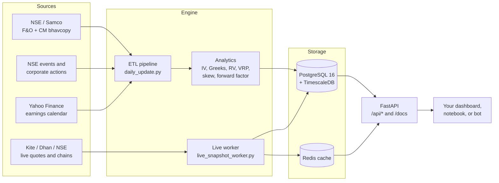

# NSE Option Chain Database

**Self-hosted NSE option chain database and volatility analytics API for Indian F&O.**

Load 5 years of NSE F&O bhavcopy history into PostgreSQL + TimescaleDB. Get contract-level implied volatility (IV) and Greeks, IV rank and percentile, and Yang-Zhang realized volatility. Get VRP, delta skew, forward factor, short-straddle backtests, earnings-move analytics, and live option chains from Zerodha Kite, Dhan, or NSE. One `docker compose up` gives you a FastAPI service with Swagger docs.

[](pyproject.toml)
[](https://fastapi.tiangolo.com/)
[](https://www.timescale.com/)
[](https://redis.io/)
[](LICENSE)
[](https://github.com/sajal101agrawal/nse-option-chain-database/stargazers)

If this project saves you time, give it a star. It helps other Indian options traders and quants find it.

---

## Contents

- [Why this project](#why-this-project)
- [Features](#features)
- [Data at a glance](#data-at-a-glance)
- [Architecture](#architecture)
- [Quick start](#quick-start)
- [Load 5 years of NSE F&O history](#load-5-years-of-nse-fo-history)
- [Daily EOD update](#daily-eod-update)
- [API reference](#api-reference)
- [Metrics glossary](#metrics-glossary)
- [Database schema](#database-schema)
- [Live option chain providers](#live-option-chain-providers)
- [Documentation](#documentation)
- [FAQ](#faq)
- [Related projects](#related-projects)
- [Contributing](#contributing)
- [Disclaimer](#disclaimer)
- [License](#license)

---

## Why this project

NSE publishes a daily F&O bhavcopy, but raw bhavcopy files do not give you IV, Greeks, skew, or a queryable history. Most options analytics tools in India are closed SaaS products. This project gives you the full stack as code:

- An ETL pipeline that downloads, validates, and stores every NSE F&O contract, every trading day.
- An analytics engine that calculates volatility metrics with documented, audited formulas.
- A REST API that serves dashboard-ready rows to your own frontend, notebook, or trading bot.

This engine runs in production behind a live NSE options research platform.

## Features

| Area | What you get |
|---|---|
| **Historical data** | Full NSE F&O and cash-market bhavcopies with automatic source fallback (Samco, NSE new archive, NSE legacy archive). |
| **Option chain database** | Every contract, every day: strike, expiry, OHLC, settle price, OI, volume, IV, delta, gamma, theta, vega, rho. |
| **Implied volatility** | Black-Scholes-Merton IV solved by bisection. ATM IV for the 30, 60, and 90 day expiry buckets. Separate call and put IV. |
| **Realized volatility** | Yang-Zhang RV for 10, 20, 30, 60, and 90 day windows, with corporate-action adjustment for splits and bonuses. |
| **Volatility analytics** | VRP, forward volatility, forward factor (average, call, put), IV term-structure slope, 20/25/30 delta skew, IV rank and percentile, volatility cone. |
| **Backtests** | Daily ATM short-straddle PnL for every symbol, plus earnings-event straddle PnL, implied move, and actual move. |
| **Events** | Result dates from NSE and upcoming earnings dates from Yahoo Finance. Corporate actions from NSE. |
| **Live data** | Live quotes and option chains from Zerodha Kite (primary), Dhan, or NSE `option-chain-v3`, with Yahoo fallback for spot prices. Live IV is calculated from live option prices. |
| **API** | FastAPI with Swagger UI at `/docs`. Redis cache in front of PostgreSQL. Paginated all-symbol dashboard endpoint. |
| **Reliability** | Retries with exponential backoff, an `error_log` table, idempotent upserts, validation scripts, and an audited formula policy. |
| **Deployment** | Docker Compose for local and production. GitHub Actions deploy to AWS EC2. Optional nightly `pg_dump` to S3. |

## Data at a glance

Numbers from the validation run on 2026-05-20, for a 5-year window (2021-05-20 to 2026-05-20). See the [validation report](docs/operations/current-validation-2026-05-20.md).

| Table | Rows |
|---|---:|
| `options_historical` (contract-level option chain) | 59,829,340 |
| `equity_historical` (underlying OHLCV) | 2,605,593 |
| `symbol_daily_metrics` (IV, RV, VRP, skew, and more) | 239,508 |
| `straddle_pnl` (daily ATM straddle backtest) | 239,511 |
| `events` (results and earnings) | 9,861 |

The active F&O universe at that date had 214 symbols: 209 stocks and 5 indices (NIFTY, BANKNIFTY, FINNIFTY, MIDCPNIFTY, and NIFTYNXT50). The check against the NSE source files for the last 5 trading days found 0 mismatches. The database-wide check found 0 formula failures.

> The repository does not include market data. You load the data on your own machine with one script.

## Architecture



## Quick start

Requirements: Docker and Docker Compose.

```bash
git clone https://github.com/sajal101agrawal/nse-option-chain-database.git
cd nse-option-chain-database
cp .env.example .env
docker compose up --build
```

Open the Swagger UI at <http://localhost:8001/docs>.

Docker Compose starts four services:

| Service | Port | Purpose |
|---|---|---|
| `postgres` | 5433 | PostgreSQL 16 with TimescaleDB. The schema loads from `sql/001_schema.sql`. |
| `redis` | 6380 | API and live-data cache. |
| `api` | 8001 | FastAPI service. |
| `worker` | none | Live quote and option-chain poller. |

Run the tests without Docker:

```bash
python3 -m venv .venv
.venv/bin/pip install -e ".[dev]"
.venv/bin/pytest -q
```

## Load 5 years of NSE F&O history

```bash
scripts/bootstrap_history.sh
```

The script creates `.env` if it does not exist, applies the schema, downloads the bhavcopies, calculates all metrics, and validates the database. Set `YEARS` or `END_DATE` to change the window:

```bash
YEARS=3 END_DATE=2026-05-20 scripts/bootstrap_history.sh
```

A full 5-year load stores about 60 million option rows. Plan for a long first run and enough disk space.

## Daily EOD update

Run one update after NSE publishes the bhavcopy for the day:

```bash
python scripts/daily_update.py --date YYYY-MM-DD
```

Install the daily cron job:

```bash
scripts/install_daily_etl_cron.sh
```

For recompute, backfill, corporate-action, and Kite login commands, see the [operations runbook](docs/operations/runbook.md).

## API reference

All routes use the `/api` prefix. The Swagger UI at `/docs` shows every parameter and response.

| Method | Route | Returns |
|---|---|---|
| GET | `/api/health` | Service health. |
| GET | `/api/system-health` | Database, cache, and live-provider status. |
| GET | `/api/symbols` | Active F&O symbols. |
| GET | `/api/sectors` | Sector list for filters. |
| GET | `/api/all-dashboard` | One paginated row for each symbol: IV, RV, VRP, skew, forward factor, percentiles, and upcoming results. |
| GET | `/api/symbol/{symbol}` | Latest metrics for one symbol. |
| GET | `/api/symbol/{symbol}/history` | Daily metric history. |
| GET | `/api/symbol/{symbol}/term-structure` | IV term structure history. |
| GET | `/api/symbol/{symbol}/volatility-cone` | Realized volatility cone. |
| GET | `/api/symbol/{symbol}/pnl` | Daily ATM short-straddle PnL. |
| GET | `/api/symbol/{symbol}/result-moves` | Earnings implied move, actual move, and straddle PnL. |
| GET | `/api/symbol/{symbol}/option-chain-history` | Historical option chain for one trade date and expiry. |
| GET | `/api/symbol/{symbol}/expiries` | Expiry calendar. |
| GET | `/api/symbol/{symbol}/events` | Result and earnings events. |
| GET | `/api/symbol/{symbol}/corporate-actions` | Splits, bonuses, and other price-adjusting actions. |
| GET | `/api/live` | Live metrics for all active symbols in one response. |
| GET | `/api/live/{symbol}` | Live metrics for one symbol. |
| GET | `/api/live/{symbol}/option-chain` | Live full option chain. |
| GET, POST | `/api/admin/*` | Pipeline triggers, error logs, and the Kite login flow. |

Example:

```bash
curl "http://localhost:8001/api/symbol/NIFTY/history?days=30"
```

> **Protect the `/api/admin/*` routes before you expose the service to the internet.** The routes have no authentication in the app. Without a guard, any visitor can start pipeline runs or replace the Kite session. Put them behind a reverse-proxy rule, a VPN, or an API key.

## Metrics glossary

All volatilities are stored as decimals. `0.284` means 28.4%. The [formula audit](docs/calculations/formula-audit.md) gives every formula, input, and null rule.

| Metric | Column | Definition |
|---|---|---|
| ATM IV | `iv_30`, `iv_60`, `iv_90` | Average ATM call and put IV for the first, second, and third monthly expiry buckets. |
| Call and put IV | `call_iv_*`, `put_iv_*` | ATM IV for each side, for the same buckets. |
| Realized volatility | `rv_10` to `rv_90` | Annualized Yang-Zhang RV, adjusted for corporate actions. |
| VRP | `vrp` | `iv_30` from 20 trading days ago minus `rv_30` today. |
| Forward volatility | `fwdv_3060` | Implied volatility between day 30 and day 60. |
| Forward factor | `fwdfct_3060`, `call_fwdfct_3060`, `put_fwdfct_3060` | `iv_30 / fwdv_3060 - 1`. A positive value means front-month IV is rich. |
| IV slope | `iv_slope_3060` | Term-structure slope from 30 to 60 days. |
| Delta skew | `skew_20`, `skew_25`, `skew_30` | Put IV minus call IV at the given delta, on the chain nearest to 30 days. |
| IV percentile | `iv_30_percentile` and others | Percentile rank of today's value against its own history. |
| RSI | `daily_rsi`, `weekly_rsi` | 14-period RSI with Wilder smoothing. |
| Straddle PnL | `straddle_pnl.pnl` | Short ATM straddle: entry at the option open, exit at the option close. |

## Database schema

The full schema is in [`sql/001_schema.sql`](sql/001_schema.sql). The [database dictionary](docs/architecture/database-dictionary.md) describes each column.

| Table | Type | Contents |
|---|---|---|
| `options_historical` | Hypertable, compressed | One row per contract per day, with IV and Greeks. |
| `equity_historical` | Hypertable | Underlying OHLCV. |
| `symbol_daily_metrics` | Hypertable | All symbol-level volatility metrics and percentiles. |
| `straddle_pnl` | Hypertable | Daily ATM straddle backtest. |
| `symbol_aggregates` | Table | Win rates, average PnL, IV crush, and result-move statistics. |
| `symbol_universe` | Table | Symbols, lot sizes, sectors, and index flags. |
| `expiry_calendar`, `trading_calendar` | Table | Expiries and trading days from loaded data. |
| `events`, `corporate_actions` | Table | Results, earnings, splits, bonuses, and dividends. |
| `live_snapshot`, `live_symbol_metrics` | Hypertable, table | Live option-chain snapshots and the latest live metrics. |
| `error_log`, `pipeline_state` | Table | Operational logs and pipeline state. |

## Live option chain providers

Set the providers in `.env`:

```text
LIVE_QUOTE_PROVIDER=kite            # kite, dhan, or yahoo
LIVE_OPTION_SUMMARY_PROVIDER=kite   # kite, dhan, or nse
LIVE_OPTION_CHAIN_PROVIDER=kite     # kite, dhan, or nse
```

Kite quotes do not include IV. The service quotes the nearest ATM call and put for each expiry target and calculates live IV with Black-Scholes. If Kite or Dhan fails, the service falls back to NSE for option data and to Yahoo for spot prices. The defaults in `.env.example` use NSE and Yahoo, so the service runs without broker credentials.

The [live option-chain architecture](docs/architecture/live-option-chain.md) gives the full design.

## Documentation

Start at the [documentation index](docs/README.md).

| Document | Topic |
|---|---|
| [Data sources](docs/architecture/data-sources.md) | Bhavcopy fallback order, risk-free rate, events, and corporate actions. |
| [Database dictionary](docs/architecture/database-dictionary.md) | Every table and column. |
| [Live option chain](docs/architecture/live-option-chain.md) | Live provider design and fallbacks. |
| [Formula audit](docs/calculations/formula-audit.md) | IV, Greeks, RV, VRP, skew, forward factor, and backtest formulas. |
| [Operations runbook](docs/operations/runbook.md) | Daily commands, recompute, backfill, and Kite login. |
| [Retries and validation](docs/operations/retries-errors-validation.md) | Retry policy, error logs, and validation scripts. |
| [AWS deployment](docs/operations/aws-deployment.md) | EC2, RDS, S3 dumps, and GitHub Actions. |

## FAQ

**How do I get historical NSE option chain data?**
Run `scripts/bootstrap_history.sh`. It downloads the daily NSE F&O bhavcopies for the last 5 years and stores every contract in `options_historical`.

**How is implied volatility calculated?**
The engine solves Black-Scholes-Merton IV by bisection from the settle price. It uses a 10% risk-free rate, which is the NSE option-chain convention.

**Does it include intraday option data?**
No. Historical data is end of day, because NSE bhavcopies are daily files. Live intraday snapshots come from the live worker.

**Which symbols does it cover?**
All NSE F&O stocks and indices in the latest bhavcopy, including NIFTY, BANKNIFTY, FINNIFTY, and MIDCPNIFTY.

**Can I use it with Zerodha Kite or Dhan?**
Yes. Add your API credentials to `.env` and select the provider. Kite needs one manual login each day, as Zerodha requires.

**Can I use it commercially?**
Yes. The code is MIT licensed. The market data has its own terms. Read the [disclaimer](#disclaimer).

## Related projects

- [nse-options-last-5-years](https://github.com/sajal101agrawal/nse-options-last-5-years): the original toolkit and dataset for 5 years of NSE options data, IV, and RV. This project is its production-grade successor.

## Contributing

Bug reports, pull requests, and feature ideas are welcome. Open an [issue](https://github.com/sajal101agrawal/nse-option-chain-database/issues) first for large changes. Run `pytest -q` before you open a pull request.

## Disclaimer

This project is for research and education. It is not investment advice. Market data belongs to NSE and the other data providers. Obey their terms of use when you download, store, display, or redistribute data.

## License

[MIT](LICENSE)

## Author

Built by **[Sajal Agrawal](https://sajal.dev)**, founder of [Sajal Tech Solutions](https://sajaltech.com).

Do you need a custom trading data platform, options dashboard, or market-data pipeline? Contact [contact@sajaltech.com](mailto:contact@sajaltech.com).
